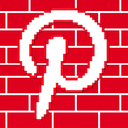

<h1 align="center">NoPinWall: Browse Pinterest Without Logging In</h1>

<p align="center">
  
</p>

<p align="center">
  <strong>A free, open-source browser extension that removes the Pinterest login popup, the dark overlay and the scroll lock, so you can use Pinterest without an account.</strong>
</p>

<p align="center">
  <a href="https://github.com/JavohirX/no-pin-wall/releases/latest"></a>
  
  
  
  <a href="LICENSE"></a>
</p>

<p align="center">
  <a href="https://github.com/JavohirX/no-pin-wall/releases/latest/download/NoPinWall.zip"><strong>Download NoPinWall.zip</strong></a>
  ·
  <a href="#install">Install guide</a>
  ·
  <a href="#faq">FAQ</a>
</p>

---

**NoPinWall** is a browser extension for Chrome, Microsoft Edge, Brave, Opera and Vivaldi. It lets you browse Pinterest as a guest: it hides the "sign up / log in" popup before it appears, removes the grey overlay behind it, and turns scrolling and clicking back on. It has no settings, collects no data, and has about 11 KB of plain JavaScript and CSS with no dependencies.

## The problem

You open Pinterest without an account, often from a Google Images result, and within a few seconds:

- a **"Log in to see more" popup** covers the pin you came to see,
- the page goes **dark or grey** and nothing behind it can be clicked,
- **scrolling stops working**, so you can't see more pins,
- a **"sign up" banner** sits at the bottom of the screen,
- and the popup **comes back** every time you open another pin or load more results.

Pinterest does this to push visitors into creating an account. NoPinWall undoes it in your own browser.

## What NoPinWall does

| Problem on Pinterest | What NoPinWall does |
| --- | --- |
| "Log in to see more" / sign-up popup (modal) | Hidden with CSS before the page paints |
| Dark / grey overlay over the page | Hidden |
| Page won't scroll | Resets the `overflow` and `position` lock on `<html>` and `<body>` |
| Pins behind the popup can't be clicked | Removes the `inert` and `aria-hidden` flags Pinterest puts on the page |
| Popup reappears after opening a pin or scrolling | Watches the page and removes each new popup as it appears |
| Bottom "sign up" banner | Hidden |

**You can still log in.** When you click **Log in** or **Sign up**, or open `pinterest.com/login`, NoPinWall steps aside and Pinterest's own login form appears. Close it and the blocking resumes.

### What it can't do

Pinterest decides how much content a logged-out visitor gets, and NoPinWall can't add content that Pinterest never sends:

- **Pin pages work fully.** If you land on a pin from Google Images or a shared link, you see the pin and can scroll through the related pins below it.
- **Search results are limited.** For logged-out visitors, a Pinterest search returns about 25 pins. They don't link to their pin pages, and scrolling doesn't load more. NoPinWall removes the popup over them, but it can't open or load pins that aren't in the page.

It runs on pinterest.com and 22 country sites: `.co.uk`, `.ca`, `.com.au`, `.de`, `.fr`, `.es`, `.it`, `.jp`, `.cl`, `.com.mx`, `.se`, `.dk`, `.ch`, `.at`, `.pt`, `.nz`, `.ie`, `.ph`, `.in`, `.co.kr`, `.nl` and `.com.br`.

## Install

NoPinWall is not on the Chrome Web Store yet, so you install it as an "unpacked" extension. It takes about a minute.

### Option 1: download the ZIP (easiest)

1. Download **[NoPinWall.zip](https://github.com/JavohirX/no-pin-wall/releases/latest/download/NoPinWall.zip)** from the [latest release](https://github.com/JavohirX/no-pin-wall/releases/latest).
2. Unzip it into a folder you will keep. The browser loads the extension from this folder, so don't delete it later.
3. Open your browser's extensions page:

   | Browser | Address |
   | --- | --- |
   | Google Chrome | `chrome://extensions` |
   | Microsoft Edge | `edge://extensions` |
   | Brave | `brave://extensions` |
   | Opera | `opera://extensions` |
   | Vivaldi | `vivaldi://extensions` |

4. Turn on **Developer mode** (a toggle at the top right; in Edge it's in the left sidebar).
5. Click **Load unpacked** and select the folder that contains `manifest.json`.
6. Open [Pinterest](https://www.pinterest.com). The popup no longer appears and the page scrolls.

### Option 2: clone with git

```bash
git clone https://github.com/JavohirX/no-pin-wall.git
```

Then follow steps 3 to 6 above and select the `no-pin-wall` folder. To update later, run `git pull` and click the reload icon on the extension's card.

## Privacy and permissions

- **No data is collected, stored or sent anywhere.** The extension makes no network requests at all.
- **It asks for no permissions.** The manifest has no `permissions` entry.
- **It only runs on Pinterest.** Because it changes Pinterest pages, Chrome shows "Read and change your data on pinterest.com sites" (plus the country domains). That is the content script that hides the popup, and nothing more.
- **You can read all of it.** The whole extension is [`content.js`](content.js), [`content.css`](content.css) and a small popup ([`popup.html`](popup.html), [`popup.js`](popup.js)).

Full policy: [PRIVACY.md](PRIVACY.md).

## Ways to use Pinterest without an account, compared

| Method | Does it work? | Catch |
| --- | --- | --- |
| Create a Pinterest account | Yes | You hand over an email address and get tracked and profiled |
| Close the popup or press Esc | Briefly at best | The popup returns as you scroll or open pins |
| Delete the popup in DevTools (Inspect, then Delete element) | Until the next popup | Scrolling often stays locked, and you repeat it on every page |
| uBlock Origin custom filters | Can work | You write the filters yourself and fix them when Pinterest changes its page |
| **NoPinWall** | **Yes** | Chromium browsers only for now (no Firefox or Safari yet); logged-out search still shows only about 25 pins |

## How it works

For developers, or anyone who wants to check what it does:

1. **CSS injected before the page paints** ([`content.css`](content.css)). The stylesheet loads at `document_start` and hides the known popup elements (`div[role="dialog"][aria-label="modal"]`, `[data-test-id="login-modal-redesign"]`, `[data-test-id="full-page-signup-modal"]` and others), so the popup never flashes on screen.
2. **Page cleanup and scroll unlock** ([`content.js`](content.js)). Marks the popup and its backdrop as hidden, strips `overflow: hidden` and `position: fixed` from `<html>` and `<body>`, and removes `inert` and `aria-hidden` from the page content. The popup containers stay in the page rather than being deleted, because Pinterest reuses them for the login form.
3. **`MutationObserver` for a single-page app.** Pinterest loads new content without reloading the page, so the extension watches for newly added popups and hides them as they appear.
4. **Steps aside for logins.** On `/login/` and `/signup/`, and after you click **Log in** or **Sign up**, the extension sets `data-nopinwall-paused` on `<html>`, which switches off both the CSS and the cleanup until the login dialog closes.
5. **Toolbar popup** ([`popup.html`](popup.html), [`popup.js`](popup.js)). Shows that the extension is active and has a **Force Clean Page** button to run the cleanup by hand.

Built on Manifest V3. No frameworks, no build step, no background service worker.

## FAQ

### How do I view Pinterest without logging in?

Install NoPinWall (see [Install](#install)), then open any Pinterest page. The "Log in to see more" popup is hidden and the page scrolls again. Pin pages, such as the ones Google Images links to, work fully. Search works too, but Pinterest only gives logged-out visitors about 25 results per search (see [What it can't do](#what-it-cant-do)).

### Why does Pinterest keep asking me to log in or sign up?

Pinterest shows a sign-up popup to visitors who aren't logged in and locks the page behind it to push them into creating an account. It shows the popup again as you scroll or open pins, which is why closing it doesn't last.

### Why can't I scroll on Pinterest without an account?

When the login popup opens, Pinterest sets `overflow: hidden` on the page so it can't scroll. NoPinWall removes that lock, and also removes the popup that comes with it.

### Is NoPinWall safe?

It collects nothing, makes no network requests, asks for no permissions, and only runs on Pinterest domains. The source is about 11 KB and you can read all of it in this repository.

### Does it let me see private boards, save pins or download images?

No. NoPinWall only removes the popup and the scroll lock. Anything that needs an account, such as saving pins, following people or seeing private boards, still needs an account.

### Does it work in Firefox, Safari or on my phone?

Not yet. It works in desktop Chromium browsers: Chrome, Edge, Brave, Opera and Vivaldi.

### The popup came back. What should I do?

Pinterest changes its page code from time to time, which can break the selectors NoPinWall looks for.

1. Click the NoPinWall icon in your toolbar and press **Force Clean Page**.
2. Reload the Pinterest tab.
3. If it still shows up, [open an issue](https://github.com/JavohirX/no-pin-wall/issues/new/choose) with the page URL and a screenshot.

### Can I still log in to Pinterest with NoPinWall installed?

Yes. Click **Log in** or **Sign up**, or go to `pinterest.com/login`, and Pinterest's login form appears as usual. NoPinWall pauses while the form is open and resumes blocking when you close it.

### Why can't I open pins from Pinterest search results?

When you're logged out, Pinterest's search results don't link to their pin pages, and Pinterest only sends about 25 of them. That limit comes from Pinterest's servers, so no extension can lift it. Pins you open from Google Images or a shared link work normally.

## Project structure

```text
no-pin-wall/
├── .github/
│   ├── ISSUE_TEMPLATE/        # "Popup came back" bug report form
│   └── workflows/
│       └── package.yml        # Builds NoPinWall.zip and publishes releases
├── icons/                     # Toolbar and store icons (16, 48, 128 px)
├── content.css                # Hides popups before the page paints
├── content.js                 # Removes popups, unlocks scrolling, watches for new popups
├── manifest.json              # Extension manifest (Manifest V3)
├── popup.html / popup.css / popup.js   # Toolbar popup with "Force Clean Page"
├── PRIVACY.md
└── LICENSE                    # MIT
```

## Contributing

Most fixes are small: Pinterest renames an element and a selector needs updating.

1. Open Pinterest while logged out and wait for the popup.
2. Right-click the popup, choose **Inspect**, and find its `data-test-id` or `role` attribute.
3. Add the selector to `SELECTORS_TO_REMOVE` in [`content.js`](content.js) and to the first rule in [`content.css`](content.css).
4. Reload the extension on the extensions page, check that the popup is gone and the page scrolls, and open a pull request.

Bug reports and feature requests go in [issues](https://github.com/JavohirX/no-pin-wall/issues).

If NoPinWall saved you from the login wall, a star helps other people find it.

## License

[MIT](LICENSE). NoPinWall is an independent project and is not affiliated with or endorsed by Pinterest, Inc.
